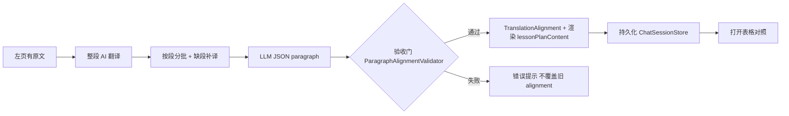

# 表格对照：整段严格一对一（AI 翻译 → 存储 → 打开）

> 文档性质：产品 + 实现设计（端到端）  
> 关联：[同步滑动翻页设计.md](./同步滑动翻页设计.md) · [aibook阅读模式.md](./aibook阅读模式.md) · [整体功能文档设计.md](../产品/整体功能文档设计.md) · `Sources/AIBook/Reading/Translation/`

---

## 1. 要解决的问题

用户打开右页 **「表格对照」** 时，期望：

| 列 | 含义 |
|----|------|
| 原文 | 左页 `fileContent` 的**第 i 段**（与本地分段规则一致） |
| 译文 | 该段对应的**唯一**译文，不多段合并、不一段拆多行 |
| 说明 | 可选注释，不破坏行与段的对应 |

**严格一对一**指：在 `TranslationAlignmentMode.paragraph` 下，对左页正文段落集合 `P[0…n-1]`，表格中恰好有 **n 行** `level == .paragraph` 的块，且 `order == i` 的块锚定在 `P[i]` 的 `NSRange` 上，`sourceText` 与 `P[i]` 文本一致（允许空白归一后相等）。

**非目标（本方案不承诺）**

- 逐字 / 逐词模式下的「一字一行」与表格行一一对应（另见同步设计 §5；表格 UI 可展示 word 行，但严格性规则不同）。
- 用户拖拽改段落边界、多译本并排。
- 讲解对话 `chatMessages` 与段落对齐。

---

## 2. 现状与缺口

### 2.1 已有能力（代码已落地）

| 环节 | 实现 | 说明 |
|------|------|------|
| 分段 | `TranslationParagraphText.contentParagraphRanges` / `TranslationPromptBuilder.countParagraphs` | 按 `\n\n` 空段切分 |
| 提示词 | `TranslationPromptBuilder` · `mode: .paragraph` | 要求 blocks 条数 = 段数、JSON 字段稳定 |
| 解析 | `TranslationAlignmentBuilder.parseJSON` · `anchorParagraphBlocks` | JSON → `TranslationBlock` + 原文锚点 |
| 降级 | `buildFromPlainText` · `TranslationParagraphSegmenter.resegment` | 段数不等时合并/按比例切 — **破坏严格一对一** |
| 应用结果 | `ReadingTranslationSession.applyTranslationResult` | 写 `translationAlignment` + `lessonPlanContent` |
| 本地对齐 | `TranslationAligner.align` · `alignTranslationWithSource` | 打开纯文本译文时重分段，**不调用 LLM** |
| 持久化 | `ChatSessionStore` · `translationAlignment` + `lessonPlanContent` | 会话 JSON |
| UI | `TranslationTableView` · `translationTableViewEnabled` | 双列可编辑；`syncBlockOffset` 微调行对齐 |

### 2.2 关键缺口（导致「表格不对齐」）

1. **入口模式不一致**  
   - 工具栏「整段翻译」若仍走 `generateLessonPlan()`，当前实现默认 **`wordByWord`**；「修订翻译」才走 **`paragraph`**。表格对照若以整段为准，**生成入口必须统一为 paragraph**。

2. **双数据源**  
   - `lessonPlanContent`（可读字符串）与 `translationAlignment.blocks` 可漂移；编辑右页纯文本后 `isStale` 或 `alignTranslationWithSource` 会用 **Segmenter 猜段数**，不再保证 LLM 原样一对一。

3. **无验收门**  
   - `applyTranslationResult` 在 JSON 解析失败或锚点未全覆盖时仍可能写入 **空块 / 未锚定块 / 降级 plain**，UI 仍显示表格，用户感知为「对不齐」。

4. **打开外部 .txt**  
   - `loadLessonPlan` 只读文本再 `alignTranslationWithSource`：没有 JSON 块时只能靠启发式，**无法保证严格一对一**（需在 UX 上区分「导入文本」与「结构化翻译」）。

5. **产品文案与模式**  
   - 「表格对照」Toggle 在逐字场景下展示 word 行；**整段严格对照**应明确：仅当 `alignment.mode == .paragraph` 且通过验收门时启用严格 UI（否则提示重新整段翻译）。

---

## 3. 设计原则（本方案追加）

在 [同步滑动翻页设计.md §2](./同步滑动翻页设计.md#2-设计原则) 之上：

| 原则 | 说明 |
|------|------|
| **段落切分单一真相** | 全链路只用一套 `SourceParagraphIndex`（见 §4），Prompt 段数、锚点、表格行数均来自它 |
| **Alignment 优先于字符串** | 持久化以 `TranslationAlignment` 为权威；`lessonPlanContent` 由 blocks **渲染**，不是手改源 |
| **验收不过不落地** | LLM 结果不满足 §5 不变量时：不写入 alignment，保留旧数据，UI 提示原因 |
| **表格即 blocks 视图** | 表格行 = `paragraph` 块按 `order` 排序；禁止表格与 blocks 各维护一份 |
| **导入与 AI 生成分轨** | 外部 .txt 导入标记 `provenance: importedPlain`；严格对照需用户执行「整段 AI 翻译」或「对齐（非严格）」 |

---

## 4. 单一真相：原文段落索引 `SourceParagraphIndex`

### 4.1 分段规则（与现网一致，写入契约）

对左页全文 `S = fileContent`（UTF-16）：

1. 归一：NFC、`\r\n`/`\r` → `\n`（与 `TranslationSourceHasher.normalize` 一致，**hash 与分段用同一归一副本**）。
2. 按 `\n\n` 切成段；去掉「仅空白」的段。
3. 得到有序列表 `ParagraphSlice[i] = (text, rangeInS)`，`rangeInS` 为在 **归一后 S** 上的 `NSRange`。

**不变量：** `TranslationPromptBuilder.countParagraphs(in: S) == ParagraphSlice.count`。

### 4.2 建议封装（实现阶段）

```swift
/// 左页段落索引：Prompt、锚点、表格行数唯一依据。
struct SourceParagraphIndex: Equatable {
    let normalizedSource: String
    let slices: [ParagraphSlice]   // text + range
    var count: Int { slices.count }
}
```

`ReadingTranslationSession.lessonPlanSourceText()` 返回的全文必须先过同一 `SourceParagraphIndex.build(from:)`，避免 Prompt 与锚点用的不是同一份左页文本（选区翻译场景见 §8）。

---

## 5. 整段 AI 翻译：生成 → 验收 → 写入

### 5.1 用户路径



长文按 `ParagraphTranslationCoverage` 分批请求（默认 10 段），截断 JSON 保住已闭合项，缺段再补最多 2 轮，最后仍走 §5.3 验收门。翻译弹出层固定高度并自动滚到最新流式输出。

### 5.2 Prompt 契约（在现有 `TranslationPromptBuilder` 上加强）

对 `mode: .paragraph`，除现有 JSON 模板外，**显式嵌入**：

- `paragraphIndex` 列表（可选）：`[{ "index": 0, "sourceText": "…" }, …]` 由客户端在 Prompt 中附上，要求模型 **逐 index 填 translationText**，禁止改 sourceText。
- 或维持 `blocks[].sourceText`，但要求 **与附件段落逐字一致**（模型只填 `translationText` / `notes`）。

推荐 **客户端附 `paragraphIndex` + 模型只回译文数组**（减小模型改段风险）：

```json
{
  "mode": "paragraph",
  "translations": [
    { "index": 0, "translationText": "…", "notes": null }
  ]
}
```

解析器映射：`index` → `ParagraphSlice[index]` → `TranslationBlock(order: index, sourceRange: slice.range, …)`。

### 5.3 验收门 `ParagraphAlignmentValidator`

在 `applyTranslationResult` **之前**执行，全部通过才写入：

| # | 检查 | 失败时用户可见原因 |
|---|------|------------------|
| V1 | `translations.count == index.count` | 段数不一致 |
| V2 | 每个 `index` 唯一且覆盖 `0…n-1` | 缺段或重复 |
| V3 | 每段 `translationText` 非空（允许 `notes` 空） | 某段未译 |
| V4 | 若仍使用 `sourceText` 字段，则与 `ParagraphSlice[i].text` 归一后相等 | 模型改写了原文段 |
| V5 | 锚定后 `anchoredBlockCount == n` | 锚点算法失败（不应在 V1–V4 通过后仍失败） |

**失败策略：** 不修改 `translationAlignment` / `lessonPlanContent`；`errorMessage` 使用 L10n；可选展示「重试 / 复制原始 JSON」。

**禁止：** 验收失败后静默走 `buildFromPlainText` 或 `TranslationParagraphSegmenter` 凑段数（可保留为 **显式**「宽松对齐」按钮，与严格整段翻译分轨）。

### 5.4 写入顺序（通过验收后）

1. 构造 `TranslationAlignment(mode: .paragraph, blocks: …, sourceContentHash: hash(S), isStale: false, syncBlockOffset: 0, isLocked: false)`。
2. `lessonPlanContent = TranslationContentFormatter.renderIndexed(alignment, title: …).content`（与 blocks 同步写回 `translationLocation/Length` 若 formatter 维护）。
3. `translationTableViewEnabled = true`（可选默认开）。
4. `host.persistChatSession()`。

### 5.5 与工具栏动作对齐（产品）

| 用户操作 | 必须 mode | 说明 |
|----------|-----------|------|
| 整段 AI 翻译 | `.paragraph` | 走 §5 全流程 + 验收门 |
| 逐字 AI 翻译 | `.wordByWord` | 表格展示 entries，**不适用** §5 严格规则 |
| 修订翻译（带指令） | `.paragraph` | 同上，Prompt 带 `existingPlan` |
| 对齐原文 | 推断 / paragraph | **宽松**：允许 Segmenter；UI 标注「非 AI 严格对齐」 |
| 表格对照 Toggle | — | 仅当 `canUseTranslationTableView`（有 alignment、未 stale、paragraph 且 V 通过或 locked） |

**代码改动要点：** `generateLessonPlan()` 改为 `mode: .paragraph`（或与 UI 文案一致的单一入口），避免「点整段却出 wordByWord」。

---

## 6. 存储与版本

### 6.1 会话内（已有字段）

`PersistedChatSession`：

- `lessonPlanContent: String?` — 渲染视图，**由 alignment 生成**；严格模式下禁止仅改 string 而不更新 blocks（或改 string 即 `isStale = true` 并禁用严格表格）。
- `translationAlignment: TranslationAlignment?` — **权威结构**。
- `translationTableViewEnabled: Bool?` — UI 状态。

### 6.2 建议扩展（可选，向后兼容）

```swift
struct TranslationAlignment: Codable {
    // 现有字段…
    var schemaVersion: Int = 1
    var strictParagraphValidated: Bool = false  // 通过 §5.3 后为 true
    var provenance: TranslationProvenance = .aiParagraphJSON
}

enum TranslationProvenance: String, Codable {
    case aiParagraphJSON      // 严格整段
    case aiWordByWordJSON
    case importedPlain        // 打开 txt + 本地 align
    case realignedHeuristic   // alignTranslationWithSource
}
```

解码缺省：`strictParagraphValidated = false`，表格 UI 对 strict 模式显示「建议重新整段翻译以恢复严格对照」。

### 6.3 导出 / 导入

| 格式 | 用途 | 严格一对一 |
|------|------|------------|
| `chat-session.json` 内嵌 alignment | 应用恢复 | 当 `strictParagraphValidated` |
| 导出 `.json`（alignment + sourceHash） | 备份、换机 | 推荐新增「导出结构化翻译」 |
| 导出 `.txt`（仅 lessonPlanContent） | 人类阅读 | **不保证** 再导入可严格对齐 |
| 导入 `.txt` | 兼容 | `provenance = importedPlain`，走宽松 align |

---

## 7. 打开与恢复

### 7.1 启动恢复（`restoreChatSession`）

1. 读 `translationAlignment`、`lessonPlanContent`。
2. 用当前 `fileContent` 计算 `hash`；与 `sourceContentHash` 不等 → `isStale = true`，表格对照降级（提示重译）。
3. 若 `alignment == nil` 且 `lessonPlanContent` 非空 → **仅** `rebuildTranslationAlignment(from:)`（宽松），`provenance = realignedHeuristic`。
4. 若 `strictParagraphValidated && !isStale` → 允许默认打开表格对照。

### 7.2 打开翻译文件（`loadLessonPlan`）

- 只读 `.txt`：设置 `provenance = importedPlain`，`strictParagraphValidated = false`，再 `alignTranslationWithSource`。
- 若未来支持 `.aibook-translation.json`：直接解码 `TranslationAlignment`，校验 hash 与 V1–V5。

### 7.3 表格 UI（`TranslationTableView`）

**整段严格模式显示规则：**

- 行 `i` 显示 `ParagraphSlice[i].text` 与 `blocks[order==i].translationText`（源以左页 slice 为准，块内 `sourceText` 不一致则标红并提示重译）。
- `syncBlockOffset`：仅允许 ±1 行视觉微调，**不**改变 `order` 与 `sourceRange` 语义（或锁定后禁止 offset）。
- 编辑译文单元格 → 只改 `translationText`，重算 `translationRange`；**禁止**在严格模式下拆分/合并 paragraph 行（禁用 `onSplitTranslation` 或仅 word 模式可用）。
- 编辑原文列 → 视为改左页段内容，应 `isStale = true` 或禁止编辑原文列（推荐 **原文列只读**）。

---

## 8. 边界场景

| 场景 | 行为 |
|------|------|
| 左页仅选区翻译 | `SourceParagraphIndex` 对 **选区字符串** 单独建 index；hash 用选区或全文+选区 range 标记 |
| 左页改一个字 | hash 变 → stale；表格顶栏提示整段重译 |
| 右页改 `lessonPlanContent` 纯文本 | 与 formatter 输出不一致 → stale；或禁止纯文本 Tab 与表格同时编辑 |
| LLM 输出 truncated JSON | 走现有 `repairTruncatedParagraphJSON`；仍不过 V1 → 失败 |
| 锁定对齐 `isLocked` | 禁止「对齐原文」重算；允许改译文 cell |

---

## 9. 测试策略（验收标准）

| 层级 | 内容 |
|------|------|
| 单元 | `SourceParagraphIndex` 与 `countParagraphs` 一致；`ParagraphAlignmentValidator` V1–V5 |
| 单元 | 固定 fixture JSON → blocks 条数 = 段数，range 覆盖全文无重叠 |
| 集成 | Mock LLM 返回合法 JSON → apply 后 `strictParagraphValidated == true`，表格行数 = 段数 |
| 集成 | 故意少一段 JSON → apply 拒绝，旧 alignment 不变 |
| 回归 | `TranslationPromptBuilderTests` 段数嵌入；`ChatSessionStore` 往返 alignment |

---

## 10. 实施阶段（建议顺序）

| 阶段 | 内容 | 主要文件 |
|------|------|----------|
| **P0** | 统一「整段 AI 翻译」入口为 `.paragraph`；验收门 + 失败不降级 | `ReadingTranslationSession.swift`、`TranslationAlignmentBuilder.swift`、新建 `ParagraphAlignmentValidator.swift` |
| **P1** | `SourceParagraphIndex` 抽取；Prompt 附 paragraph 列表或 index-only JSON | `TranslationPromptBuilder.swift`、`TranslationParagraphText.swift` |
| **P2** | `strictParagraphValidated` / `provenance`；恢复与 stale 逻辑 | `TranslationBlock.swift`、`ChatSessionStore.swift`、`ReadingViewModel.restoreChatSession` |
| **P3** | 表格 UI：原文列只读、严格模式禁用 split、stale 横幅 | `TranslationTableView.swift`、`ExplanationChatView.swift` |
| **P4** | 导出/导入结构化 JSON；文档与 `功能说明书` 同步 | `ReadingTranslationSession`、docs |

---

## 11. 文档同步（规约第 10 节）

| 改动落地后 | 更新 |
|------------|------|
| 整段翻译 / 表格对照行为 | 本文、`docs/阅读/同步滑动翻页设计.md` §4 交叉链接 |
| 用户可见说明 | `docs/产品/功能说明书.md` · Resources 副本 |
| 源码目录 | `Sources/AIBook/Reading/Translation/功能说明.md` |

---

## 12. 与现有《同步滑动翻页设计》的关系

- **同步滑动翻页设计**：双模式对齐底座、scroll 同步、阅读模式对照翻页（广度）。
- **本文**：**整段 + 表格对照** 的 **严格 1:1** 契约，从 AI 输出到存储到打开的 **闭环与验收**（深度）。

实现时以本文 §5–§7 为表格对照的验收标准；scroll 同步仍遵循同步设计 §4.2，但仅对 `isAnchored && !isStale` 的 paragraph 块生效。
